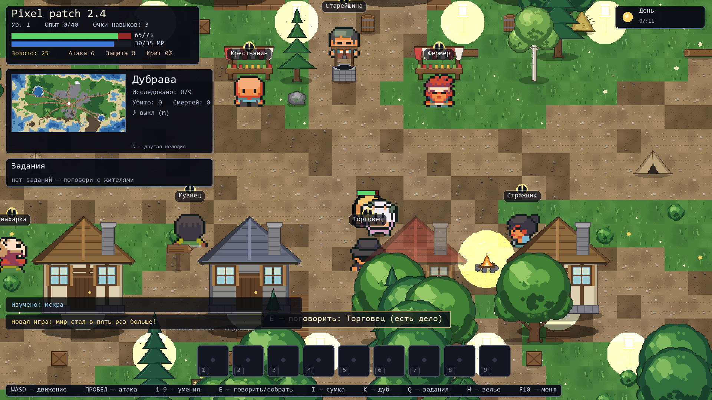
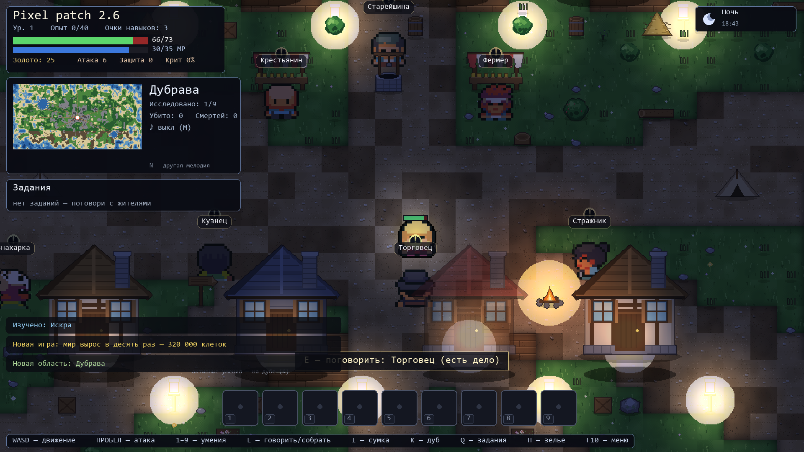
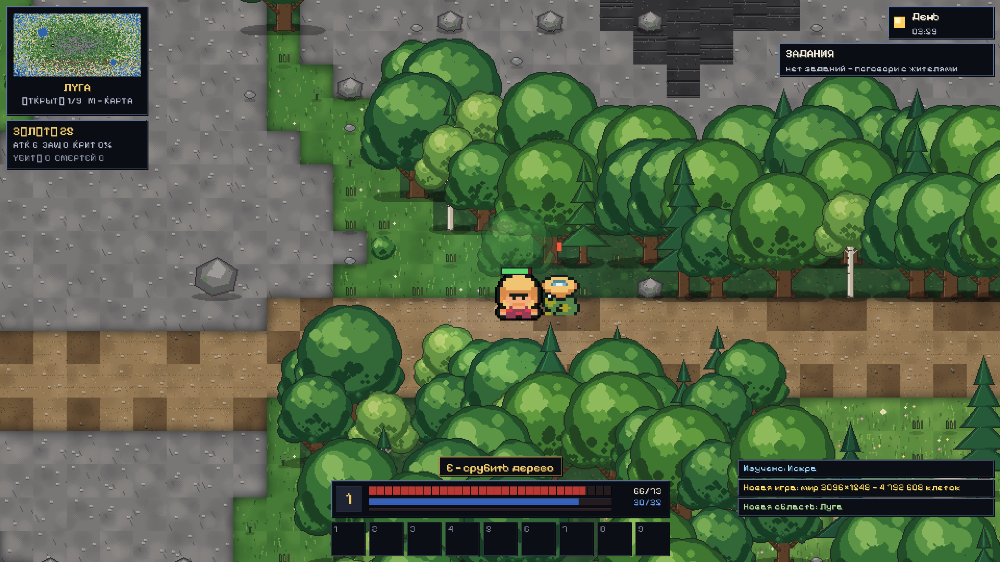
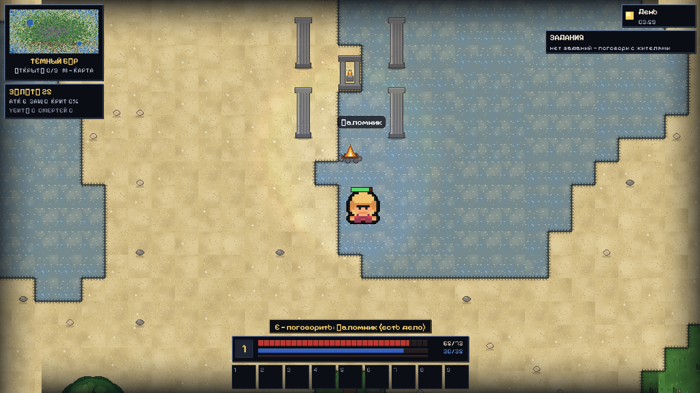
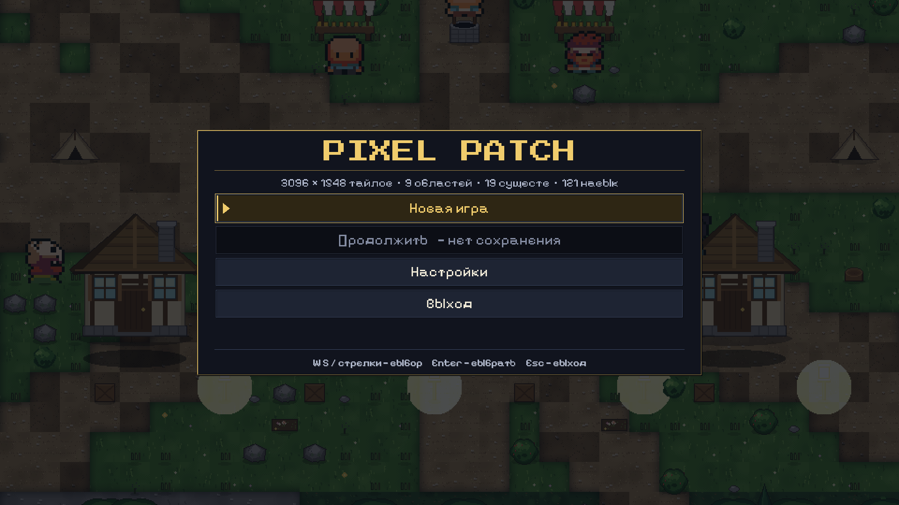

# Pixel patch

Пиксельная RPG с открытым миром: остров из девяти областей, 19 существ, торговля,
звук и дерево из 121 навыка на одном большом дубе. Две реализации одной игры:

| Версия | Технологии | Где запускать |
|---|---|---|
| **2.6** (активная) | Python + pygame-ce, сборка в `.exe` | `python/game.py` или `PixelPatch.exe` |
| **1.0** | HTML + p5.js | `index.html` в браузере |

## Скриншоты












## Играть

**Скачать `.exe`:** вкладка [Releases](../../releases) → `PixelPatch.exe` (Windows,
Python не требуется) — двойной щелчок. Первый запуск дольше обычного: мир
(4 792 608 клеток) генерируется примерно 4 секунды, на экране видна полоса
прогресса с текущим этапом.

**Веб-версия 1.0:** https://hiddencars.github.io/pixel-rpg-adventure/

**Из исходников:**
```bash
cd python
python -m venv .venv
.venv/Scripts/pip install -r requirements.txt   # Linux/macOS: .venv/bin/pip
.venv/Scripts/python game.py
```

## Управление

| Клавиши | Действие |
|---|---|
| `WASD` / стрелки | движение |
| `ПРОБЕЛ` / ЛКМ | атака |
| `1`–`9` | активные умения (мана и перезарядка показаны в панели) |
| `E` | говорить с NPC, взять ресурс рядом (дерево, камень, куст, цветок) |
| `1`–`3` в диалоге | взять задание у жителя |
| `Enter` в диалоге | сдать выполненное задание |
| `TAB` | в торговле — переключить «Продать» / «Купить» |
| `R` | в торговле — продать все материалы разом |
| `I` | **сумка** (24 слота): стрелки — выбор, `E`/`Enter` — надеть или использовать, `ПРОБЕЛ` — выбросить |
| `K` | **дуб навыков**: стрелки/WASD или мышь — по ветвям, колесо мыши и `+`/`−` — зум, `F` — весь дуб, `Enter` — изучить |
| `Q` | журнал заданий |
| `H` | выпить зелье здоровья |
| `R` | сесть на лошадь / слезть (лошадка недалеко) |
| `M` | **карта мира**: весь остров, туман войны, подписи областей |
| `N` / `F7` | музыка: следующая мелодия / включить-выключить |
| `F5` / `F9` | сохранить / загрузить |
| `F10` | меню и **настройки** (экран, звук, управление, игра) |
| `F11` | полный экран |
| `ESC` | закрыть панели / пауза / выйти из меню |

## Мир

Карта **3 096×1 548 тайлов** (4 792 608 клеток — в пятнадцать раз больше, чем в 2.6) с биомами:

| Область | Что там |
|---|---|
| Дубрава | деревня: дома, колодец, рынки, кузнец, торговец, знахарка, стражник |
| Луга | гоблины, слизни, кабаны, коровы, овцы, курицы |
| Тёмный бор | гоблины-здоровяки, волки, пауки, змеи, медведи |
| Гнилая топь | слизни, змеи, тролли, бесы |
| Кряж | орки, големы, скелеты, летучие мыши, тролли |
| Руины Аргоса | скелеты, призраки, разбойники, големы |
| Погост | скелеты, призраки, бесы |
| Логово разбойников | разбойники, здоровяки, волки |
| Берег | гоблины, слизни, курицы |

За первое посещение каждой области даётся опыт; прогресс виден на миникарте.

## Стоянки и события

По всему острову разбросано **84 стоянки**: руины, сторожевые башни,
лагеря, хутора, шахты, святилища, рыбацкие станы, погосты, кочевья, ветряные
мельницы и пасеки. Каждое место
расчищено от леса, обставлено по своему шаблону и, как правило, обитаемо —
там живёт NPC, у которого есть работа. Найденные стоянки отмечаются на карте
мира (`M`) цветными точками.

За пределами размеченных областей (это 18% суши) тоже есть жизнь: там бродят
звери и гоблины, хотя стоянок и квестов туда не ставили.

Мир живёт и сам: раз в 1–2.5 минуты рядом с игроком что-то происходит.

| Событие | Что это |
|---|---|
| **Налёт** | стая мобов области идёт по следу игрока |
| **Брошенный ящик** | клад: золото и три случайных предмета |
| **Упавшая звезда** | редкая руда и самоцветы на месте падения |
| **Караван** | временный торговец, уходит через две минуты |
| **Странник** | даёт монету и слух о дальних землях |
| **Зверь** | один крупный и злой моб с двойным здоровьем и опытом |

## Лошади

Пешком карта в 3 096 тайлов шириной пересекается за одиннадцать минут — верхом
меньше чем за пять. По острову стоят одиннадцать лошадей: одна у ворот деревни,
по одной в каждом кочевье и дикие табуны в лугах (дикая лошадь чуть светлее).
Подойди и нажми `E`, чтобы сесть, `R` — чтобы спешиться; всадника можно сбить
ударом. Лошадь, с которой слез, остаётся стоять на месте.

## Инвентарь, лут и торговля

С врагов падает золото и трофеи (шкуры, клыки, руды, самоцветы, кости, яд, паутина,
оружие и броня) — они лежат на земле и подбираются при подходе. Всё собранное попадает
в **сумку на 24 слота**, предметы складываются в стеки.

**Торговец** на площади покупает трофеи за 45% цены и продаёт свой товар за 160%.
Вкладка «Продать» показывает выручку, «Купить» — запас торговца; `R` продаёт все
материалы сразу.

Экипировка — четыре слота: **оружие, броня, кольцо, амулет**. Оружие прибавляет атаку,
броня — защиту, кольца и амулеты дают здоровье, ману, крит и магию. Итоговые
характеристики видны в HUD.

## Задания, сбор и музыка

**Задания** берутся у **четырнадцати** заказчиков: семь мирных жителей деревни и семь
обитателей стоянок — разведчик, охотник, рудокоп, рыбак, паломник, отшельник и
кочевник. Подойди и нажми `E`, затем `1`–`3`, чтобы взять. Всего их **106** и они
разные: отбить стаю гоблинов у огородов,
срубить дрова на зиму, набрать ягод и трав, добыть руду, найти потерянное, доставить
товар, продать трофеи, изучить навыки, побывать в дальних областях и одолеть
главарей. У жителя, у которого есть новое дело, висит `!`, у готового к сдаче — `?`;
сдаёшь там же клавишей `Enter`. Журнал — `Q`, три активных задания видны в HUD.

**Сбор ресурсов**: рядом с деревом, камнем, кустом или цветком появляется подсказка
`E — срубить дерево` и так далее. Срубленное дерево оставляет пень и открывает
проход, а через пару минут всё вырастает заново — остров не истощается.

**Музыка**: восемь тем (титульная, деревня, лес, топь, кряж, руины, погост и боевая)
синтезируются прямо в игре, переключаются по области и на бой при появлении врагов
рядом. `F7` — выключить или включить, `N` — послушать следующую, `M` — карта мира.

## Благодарности

- **Графика персонажей и монстров:** [Ninja Adventure](https://pixel-boy.itch.io/ninja-adventure-asset-pack) — CC0.
- **Шрифты:** [Pixelify Sans](https://github.com/eifetx/Pixelify-Sans) и
  [Press Start 2P](https://zone38.net/font/) — SIL Open Font License 1.1,
  тексты лицензий лежат в `python/assets/fonts/`.

## Дуб навыков

`K` открывает один большой дуб с **121 узлом** в пяти ветвях:

| Ветвь | О чём |
|---|---|
| Клинок | урон, криты, размашистые удары, казнь |
| Оплот | броня, здоровье, шипы, блок, землетрясение |
| Чары | мана, огонь, лёд, метеор, телепорт |
| Чаща | скорость, уклонение, яды, волки-спутники |
| Исток | лечение, регенерация, золото, удача в добыче |

Каждая ветвь — восемь ярусов по три узла. Пассивные умения складываются в
характеристики, 34 активных попадают в панель `1`–`9` со своей ценой маны и
перезарядкой. Очко навыка даётся за уровень и за выполнение квестов.

## Звук

35 эффектов синтезируются прямо в игре — внешних файлов нет: замах меча, удар по плоти
и по костям, смерть врага, удар по герою, подбор предмета, монеты, зелье, новый
уровень, изучение навыка, выполненный квест, шаги, меню, диалог, торговля, огонь, лёд,
волчий вой, шёпот призрака и другие.

## Настройки

`F10` (или «Настройки» в главном меню) открывает экран с четырьмя вкладками:

| Вкладка | Что там |
|---|---|
| **Экран** | пять разрешений (960×540 … 1920×1080) и полноэкранный режим |
| **Звук** | громкость эффектов и музыки ползунками (шаг 10%) и общий выключатель |
| **Управление** | переназначение всех действий: движение, атака, действие, сумка, дуб, задания, зелье, музыка. `Enter` — назначить клавишу, `ESC` — отмена; занятая клавиша меняется местами, есть сброс по умолчанию |
| **Игра** | сложность (лёгкая / обычная / суровая), цифры урона, тряска экрана, миникарта, подсказки, автосохранение |

Навигация: `TAB` — вкладка, `↑`/`↓` — строка, `←`/`→` — значение, `Enter` — выбрать,
`ESC` — назад. Всё сохраняется в `~/.pixel_rpg_adventure_config.json` и применяется
сразу.

## Графика

Мир, тайлы, объекты и иконки рисуются процедурно (`art.py`, `sprites.py`), а
персонажи и монстры — спрайтами из набора
[Ninja Adventure Asset Pack](https://pixel-boy.itch.io/ninja-adventure-asset-pack)
(Pixel-Boy, лицензия CC0, public domain). В `python/assets/ninja` лежат только
используемые листы; если папки нет, игра откатывается на процедурных персонажей.

### Свет и время суток (HD-2D)

Сверху на кадр кладётся карта света в логическом разрешении и умножается на него
(`BLEND_RGB_MULT`). «Амбиент» — это цвет множителя: в полдень он почти белый и
картинку не меняет, ночью уводит всё в синий. Кострища, фонари и окна домов
добавляются к карте аддитивно, поэтому ночью видны тёплые островки света, а не
ровная темнота; герой носит с собой немного света, иначе не видно, куда идти.

Полные сутки — 8 минут (`lighting.DAY_LENGTH`), новая игра начинается утром.
В HUD справа сверху — солнце/луна, название фазы и игровые часы. Отключается в
настройках: «Игра» → «Свет и время суток».

Стоимость — **~1.3 мс на кадр** при 1920×1080 и 18 источниках в кадре: один `fill`
карты, 19 blit'ов готовых градиентов и один мультиплай по 960×540. Градиенты
попиксельные (концентрические круги читались как плоский диск) и кэшируются по
радиусу и цвету, поэтому пересборки в кадре нет.

## Разрешение экрана

В меню («Настройки») выбирается разрешение:

| # | Разрешение | Масштаб |
|---|---|---|
| 1 | 960×540 | ×1 |
| 2 | 1280×720 (HD) | ×2 |
| 3 | 1366×768 | ×2 |
| 4 | 1600×900 | ×2 |
| 5 | **1920×1080 (Full HD)** | ×2 |

Выбор сохраняется в `~/.pixel_rpg_adventure_config.json`. Можно задать сразу:
`PixelPatch.exe --res 1920x1080` (или `--fullscreen`). Мир масштабируется только
целочисленно, поэтому пиксели остаются резкими; текст рисуется в родном разрешении.

## Сборка `.exe`

```bash
cd python
python build_exe.py
```
Результат — `python/dist/PixelPatch.exe`. Скрипт сначала прогоняет
`game.py --selftest` (headless-проверка мира, боя, лута, торговли, дерева навыков,
сохранения и отрисовки всех экранов) и собирает exe только если проверка прошла.

## История изменений

См. [CHANGELOG.md](CHANGELOG.md).

## Структура

```
index.html            веб-версия 1.0 (p5.js)
python/game.py        логика игры, мир, бой, задания, сбор, сохранения, точка входа
python/render.py      отрисовка, интерфейс, дуб навыков, главный цикл
python/world.py       генерация острова: биомы, деревня, области
python/art.py         тайлы 32×32 и объекты мира (предрендер)
python/lighting.py    карта света и суточный цикл (HD-2D)
python/sprites.py     существа 64×64 и иконки предметов
python/items.py       предметы, экипировка, лут-таблицы, товар торговца
python/skills.py      дерево из 121 навыка и его раскладка по ветвям
python/quests.py      106 заданий, их заказчики и цепочки
python/sounds.py      35 синтезированных звуковых эффектов
python/music.py       8 синтезированных фоновых тем
python/selftest.py    headless-проверка (используется сборкой)
python/playtest.py    headless-прогон боя, сбора и заданий с отрисовкой кадров
python/shot.py        рендер кадров в PNG (отладка)
python/build_exe.py   сборка .exe через PyInstaller
python/requirements.txt
```
